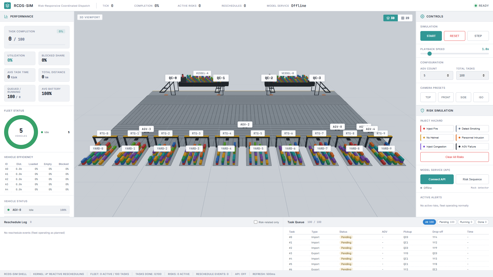
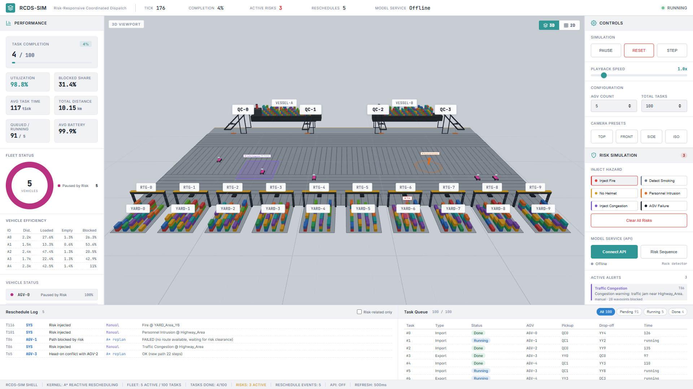
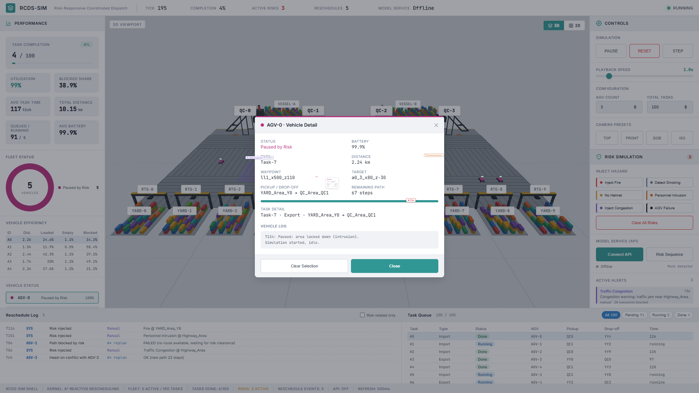
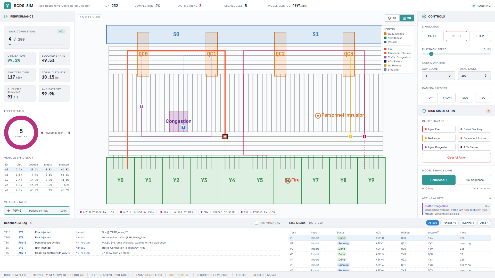

# RCDS · Risk-Responsive Coordinated Dispatch Simulation

A digital-twin rehearsal platform for automated container terminals. A browser
3D/2D visualisation shell is driven by a risk-responsive dispatch kernel: safety
risks are perceived (manually injected or discovered by a model service), turned
into hard spatial constraints, and the AGV fleet re-plans around them in real time.

## What it does

- **Terminal digital twin** — 1 620-waypoint road network, 3 887 directed edges,
  quay cranes, yard blocks, vessels and an AGV fleet rendered in the browser.
- **Six risk types** — fire, smoking, no helmet, personnel intrusion, traffic
  congestion, AGV failure. Each one maps to a concrete scheduling action.
- **Reactive rescheduling** — every tick, every AGV independently claims a task,
  plans with A\*, reserves nodes, hands over cargo, and re-plans when blocked.
- **Turn-cost-aware planning** — the A\* cost includes a penalty for every
  direction change, so routes stay smooth instead of zig-zagging.
- **2D / 3D viewport** — the same back-end state rendered either as a 3D scene or
  as a top-down road-network map, switchable with one click.
- **Operator console** — live KPIs, reschedule log, task queue, alert feed and
  per-vehicle detail.

## Screenshots

Idle state after the launcher starts (5 AGVs, 100 tasks). The right-hand rail
carries the simulation controls, the six risk injections and the model-service
panel; the bottom dock holds the reschedule log and the task queue.



Three risks injected at once — traffic congestion, personnel intrusion and fire.
All five vehicles are paused by the intrusion while the congestion blocks the
waypoints in its radius, and the reschedule log records the evidence of every
decision (`Risk injected`, `Path blocked by risk · A* replan`, head-on yielding).



Clicking a vehicle opens its detail: status, battery, distance, current task,
waypoint and target, remaining A\* path, and the vehicle event log.



The 2D viewport renders the same state as a top-down road-network map. Planned
paths (solid) and travelled trails (dashed) are drawn for every vehicle at all
times, with the blocked congestion area, risk markers and a legend.



## Risk semantics

| Risk | Scheduling action |
|---|---|
| Fire | Job point locked down, its task returns to the queue |
| No helmet | Job point locked down, its task returns to the queue |
| Personnel intrusion | Every AGV inside the highway area is paused (zone-wide) |
| Traffic congestion | All waypoints within the impact radius are blocked; A\* reroutes around them |
| AGV failure | AGV releases its task, waits for rescue, returns to the depot, then is decommissioned |
| Smoking | Alert only, scheduling is unchanged |

## Quick start

The back end has a single third-party dependency, so a dedicated virtual
environment stays tiny (Python 3.13 + `websockets` = two packages).

```powershell
# 1. Python environment (Windows)
python -m venv .venv
.\.venv\Scripts\python.exe -m pip install websockets

# 2. Frontend dependencies (installed into frontend/node_modules)
cd frontend; npm install; cd ..

# 3. Run
.\.venv\Scripts\python.exe run.py                    # launcher: backend + frontend, opens the browser
.\.venv\Scripts\python.exe run.py online             # backend only (WebSocket on :8000)
.\.venv\Scripts\python.exe run.py sim  -n 4 --tasks 20    # headless simulation, no risks
.\.venv\Scripts\python.exe run.py risk -n 4 --tasks 20    # headless run of the full risk scenario
```

On macOS or Linux use `.venv/bin/python` instead of `.venv\Scripts\python.exe`
(or activate the environment and call `python`).

`run.py` starts the back end with `sys.executable`, so anything launched from the
virtual environment stays inside it. The launcher also works with a plain system
Python if you would rather not use a virtual environment.

`requirements.txt` declares the same single dependency (`websockets>=12.0`) if you
prefer `pip install -r requirements.txt`. Node.js 18+ is needed for the frontend.

Defaults are 5 AGVs and 100 tasks; `-n` and `--tasks` override them.


## Layout

```
RCDS/
├── rcds/
│   ├── port/          A* graph search and road-network loading
│   ├── safety/        risk ledger, model-service connector
│   ├── core/          simulation loop, AGVs, tasks, metrics
│   ├── models/        shared data structures and configuration
│   ├── server.py      WebSocket service
│   └── launcher.py    one-command launcher (frontend + backend)
├── frontend/          React + react-three-fiber UI (3D scene, 2D map, panels)
├── data/network/      terminal road-network assets
├── tests/             kernel tests and end-to-end WebSocket tests
└── run.py             CLI entry point
```

## WebSocket protocol

Server to client: `network`, `jobPoints`, `state_update`, `speed`, `finished`, `error`.

Client to server:

| Action | Parameters | Effect |
|---|---|---|
| `start` / `pause` | — | run or hold the simulation clock |
| `step` | — | advance exactly one tick |
| `reset` | `numAgvs`, `numTasks`, `seed` | rebuild fleet and task set, clear all risks |
| `setSpeed` | `speed` | playback multiplier |
| `addRisk` | `riskType`, `zone`, `jobPointId`, `agvId`, `locationWp`, `duration` | inject one risk |
| `clearRisks` | — | release every risk and resume the fleet |
| `setApiSimulation` | `enabled` | start or stop model-service polling |
| `triggerRiskSequence` | — | inject the six risk types in a preset order |

## Dispatch kernel

Planning is a single A\* implementation (`rcds/port/graph.py`) whose search state
is `(waypoint, incoming direction)`. Direction changes add a fixed penalty, which
keeps the heuristic admissible and the result optimal for the combined cost of
distance plus turning.

Node reservation is resolved to a fixpoint on every tick: an AGV may only enter a
cell whose occupant is already approved to leave. That rule is what keeps the
fleet from ever occupying one waypoint twice or moving along a non-existent edge.

## Energy model

Battery drains per metre driven, and only while a vehicle is moving, so a parked
vehicle can never mask a risk. One full charge covers `battery_range_km = 3 600`
per vehicle, which — at the default 5-AGV scenario where a task costs the fleet
about 1.8 km (0.36 km per vehicle) — is roughly one charge per 10 000 tasks.
Measured: 100 tasks leave the fleet at 99.0 %, 1 000 tasks at 90.0 %, and a full
10 000-task run finishes with 0.4 % left.

## Verification

```powershell
.\.venv\Scripts\python.exe tests\test_kernel.py            # kernel assertions
.\.venv\Scripts\python.exe tests\ws_e2e.py --port 8000     # protocol, clock, risk injection, reroute evidence
```

The end-to-end suite needs a running back end (`run.py online` in another
terminal). Both suites are green inside the virtual environment: 145 kernel
assertions and 56 protocol assertions.

The kernel tests walk a full run tick by tick and assert the two invariants above
on every single step, in addition to graph, risk-ledger, linkage and turn-cost
checks.

## Measured results

Headless runs with a fixed seed (`python run.py sim`):

| Fleet / tasks | Ticks | Completion | Total distance |
|---|---|---|---|
| 5 / 100 (default) | 2319 | 100 % | 180.3 km |
| 4 / 20 | 658 | 100 % | 39.4 km |
| 6 / 30 | 704 | 100 % | 56.1 km |
| 8 / 60 | 970 | 100 % | 107.6 km |
| 12 / 100 | 1102 | 100 % | 194.6 km |
| 16 / 120 | 1170 | 100 % | 244.1 km |

The full risk scenario (`python run.py risk`, 4 AGVs / 20 tasks) finishes in
1 004 ticks with 22 reschedule events and every task completed.

Turn-cost planning was measured against plain distance-only A\* on the same
scenario: average turns per leg fell from 7.33 to 1.77 and total distance dropped
by about 7 %, because zig-zag routes are also longer routes.

## Limitations

- Dispatch is a reactive greedy policy, not a globally optimal multi-robot plan.
- The intrusion pause is zone-wide rather than lane-accurate.
- The 2D map is read-only with a fixed aspect ratio (no pan or zoom).
- Decommissioned AGVs are never revived within a run.
- Battery level is informational: a vehicle at 0 % keeps working.

## License

MIT — see [LICENSE](LICENSE).
